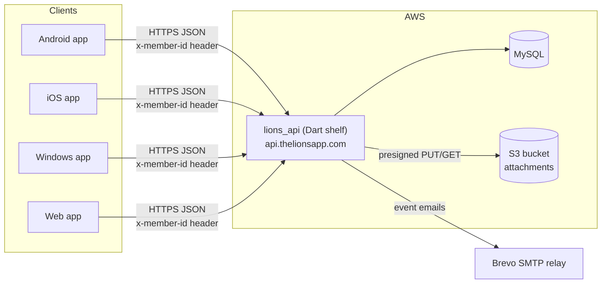
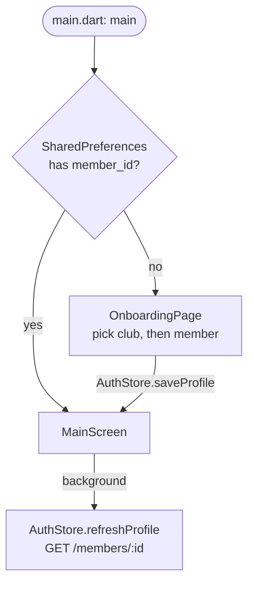
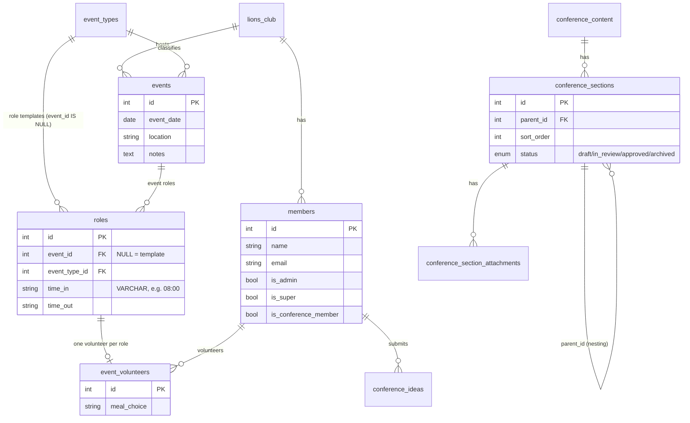
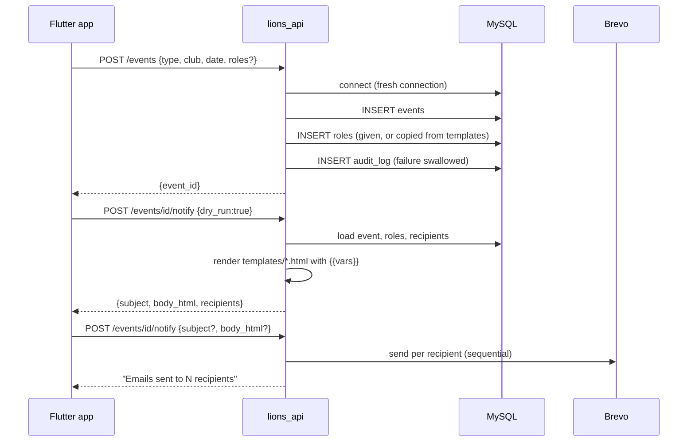
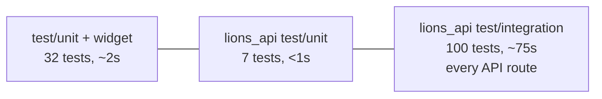

# Lions App — Architecture

**Last updated:** 16 November 2026
**Companion documents:** [regression_suite_plan.md](./regression_suite_plan.md) (test strategy and known gaps) · [TESTING.md](./TESTING.md) (how to run the test suites)

This document describes how the Lions App is put together: the moving parts, how they talk to each other, and the conventions the codebase follows. It is written for anyone maintaining the app — including a future you.

---

## 1. System overview

The system has two codebases in one repository:

| Component | Technology | Location | Purpose |
|---|---|---|---|
| **Client app** | Flutter (Dart) | `lib/` | UI for members: events, volunteering, calendar, conference, reports |
| **API server** | Dart (shelf) | `lions_api/` | HTTP/JSON API, business rules, email, attachments |
| **Database** | MySQL 8 | AWS (prod), Docker (test) | All persistent data |
| **Email** | Brevo SMTP relay | `smtp-relay.brevo.com:587` | Event notification emails |
| **File storage** | AWS S3 (`ap-southeast-2`) or local mock | — | Conference section attachments |

Key properties:

- **Stateless API** — every request opens its own MySQL connection and closes it afterwards; there are no server-side sessions.
- **Identity by header** — the client sends `x-member-id` with each request (see §4.2; this is a placeholder, not real authentication).
- **Single conference document** — the conference feature maintains one `conference_content` row with nested sections.
- **Soft deletes for conference data** — sections and attachments are archived (`status = 'archived'`), never destroyed. Events/members/clubs are hard-deleted.

---

## 2. Flutter client (`lib/`)

### 2.1 Boot and authentication flow

There is **no password login**. Onboarding (`onboarding_page.dart`) loads the club list, then the members of the chosen club; selecting yourself stores your `member_id`, `club_id`, and role flags in `SharedPreferences` via [`AuthStore`](lib/auth_store.dart). Every subsequent API call sends that member id as the identity.

### 2.2 Navigation and pages

`MainScreen` (`main.dart`) is a tab shell that switches at an **800 px breakpoint** between a `NavigationRail` (desktop/tablet) and a `BottomNavigationBar` (mobile). Tabs: Home, Members, Events, Calendar, Conference, News. Reports is an AppBar action shown only to admins/supers; club management, role templates, and the audit log are reached from Home.

| Page | File | Notes |
|---|---|---|
| Home | `main.dart` (`HomePage`) | Dashboard tiles, entry to admin pages |
| Members | `members_page.dart` | List/edit members; admin controls gated by flags |
| Events | `events_page.dart` | Upcoming events, filters, create dialog, email flow |
| Event detail | `event_detail_page.dart` | Roles, volunteer sign-up, PDF export, email send |
| Create event | `create_event_dialog.dart` | Type/club/roles; copies role templates |
| Calendar | `calendar_page.dart` | `table_calendar` view of all events |
| Conference | `conference_page.dart` | Section tree, attachments, editing for conference team |
| Conference ideas | `conference_ideas_page.dart` | Idea submission and moderation |
| Reports | `reports_page.dart` | Three report endpoints, date presets, CSV export |
| Role templates | `role_templates_page.dart` | Per-event-type default roles |
| Event types | `event_type_management_page.dart` | Type CRUD |
| Clubs | `manage_clubs_page.dart` | Club CRUD (super) |
| Audit log | `audit_log_page.dart` | Super-only change history |
| Onboarding | `onboarding_page.dart` | First-run profile selection |

### 2.3 State management and data access

- **State:** plain `StatefulWidget` + `setState`. There is no Provider/Riverpod/Bloc layer. Cross-page state lives in `SharedPreferences` (profile/role flags) accessed through static `AuthStore` helpers.
- **HTTP:** [`ApiClient`](lib/api_client.dart) wraps `package:http` with the base URL and headers (JSON + `x-member-id`). *Caveat:* many pages still call `http.*` directly, bypassing the wrapper and its auth header (gap A3 in the plan); `calendar_page.dart` even hardcodes `localhost` (gap A2).
- **Base URL:** [`config.dart`](lib/config.dart) resolves at compile time via `--dart-define`: `USE_AWS` (default true → `https://api.thelionsapp.com`), with local-dev fallbacks per platform.
- **UI permission gating:** widgets read `AuthStore.isAdmin()/isSuper()/isConferenceMember()` to hide controls. This is cosmetic only — enforcement must come from the API (see §4.2).

### 2.4 Platform specifics

- **Email HTML editing:** `widgets/email_html_editor.dart` currently always exports the plain-text stub; the rich web editor is parked as `email_html_editor_web.disabled.dart`.
- **PDF export:** `event_detail_page.dart` uses `pdf` + `printing` to generate/share event rosters.
- **File picking:** a vendored fork of `file_picker` lives in `third_party/file_picker` (pinned via `dependency_overrides`).

---

## 3. Database

Schema source of truth: [`lions_api/migrations/create_schema.sql`](lions_api/migrations/create_schema.sql) plus incremental migrations in the same folder. The API also self-heals one column at startup (`conference_sections.parent_id`) — see §4.5.

Conventions and quirks worth knowing:

- **Role templates and event roles share the `roles` table**, distinguished by `event_id IS NULL` (template) vs set (live role). Creating an event with no explicit roles copies the type's templates.
- **One volunteer per role** is enforced by the unique key `uq_event_role (event_id, role_id)`; assignment is an upsert.
- **Times are strings** (`VARCHAR '08:00'`), sorted in SQL via `STR_TO_DATE`.
- **The MySQL driver returns everything as strings** — ids and flags arrive as `'1'`, not `1`. Both API and client normalize truthiness with an `_isTruthy`-style check (`1 / true / '1' / [1]`). API JSON responses therefore serialize ids as strings.
- **`audit_log`** records CREATE/UPDATE/DELETE (and conference ARCHIVE/RESTORE/REORDER) with JSON old/new values; audit insert failures are deliberately swallowed.
- **Seed data:** `create_schema.sql` seeds one club, one super-admin member, and a "Dinner Meeting" event type.

---

## 4. API server (`lions_api/`)

### 4.1 Shape

The entire server is one file, [`bin/lions_api.dart`](lions_api/bin/lions_api.dart) (~5,000 lines): configuration at the top, then handler functions, then a `_router()` route table and `main()`. There is no service/repository layering (a planned refactor — Phase 6 of the test plan). Routing is `shelf_router`; CORS is permissive (`*`) via middleware.

Route groups (every route has integration test coverage — see `lions_api/test/integration/`):

| Group | Routes | Write permissions |
|---|---|---|
| Members | CRUD `/members` | update: admin/super/self; **create & delete: none (gap B16)** |
| Clubs | CRUD `/clubs` | super only |
| Events | CRUD `/events`, `/events/calendar`, `/events/<id>/calendar.ics` | update: admin/super; **create & delete: none (gap B17)** |
| Volunteers | assign/unassign under `/events/<id>/volunteers` | **none (gap B17)** |
| Event types & templates | CRUD `/event_types`, `/event_types/<id>/role_templates`, `/roles/<id>` | admin/super |
| Meal options | CRUD `/dinner_meal_options` | admin/super |
| Conference | `/conference`, `/conference_sections/**`, attachments, `/conference_ideas` | all routes require identity; editing requires super **or conference member** (admins cannot edit) |
| Reports | `/reports/{events,volunteers,fill_rates,club_comparison}` | any identity; club comparison super-only |
| Audit | `/audit_logs` | super only |
| Email | `POST /events/<id>/notify` | any caller |

### 4.2 Identity model (important)

`_getMemberIdFromRequest` trusts the **`x-member-id` header** (or `_auth_member_id` query param). The code labels this a placeholder for future JWT/session auth. Consequences:

- Identity is **spoofable** — authorization checks (`_isSuper`, `_isAdmin`, `_isConferenceMember`, `_canEditConference`) are real, but they authorize whichever id the caller claims.
- Enforcement is **per-handler**, not middleware, and inconsistent: conference routes check everything; several member/event writes check nothing (gaps B1/B2/B16/B17).
- The permission matrix in the integration tests (`test/integration/`) is the executable specification of who-can-do-what, and the place where fixing auth will surface as deliberate test updates.

### 4.3 Request lifecycle

Typical mutation (create event, then notify members):

### 4.4 Email

- Templates live in `lions_api/templates/` as subject/body pairs for three flows: **new event**, **assigned reminder**, **resend unfilled**. `{{variable}}` substitution is simple string replacement (no HTML escaping — gap B4). Template-file contracts are locked by `test/unit/email_templates_test.dart`.
- Sender is always `noreply@thelionsapp.com`; the club personalizes `From`-name and `Reply-To` (columns on `lions_club`).
- The notify endpoint supports `dry_run` (returns rendered preview + recipients — this is what the app's preview/edit UI uses), `only_assigned`, `resend_unfilled`, and subject/body overrides.
- SMTP credentials come from `SMTP_USER`/`SMTP_PASS` env vars; TLS verification is currently disabled (gap B3).

### 4.5 Attachments

Conference section attachments use a presign-upload-register pattern controlled by `ATTACHMENTS_PRESIGN_MODE`:

- **`mock` (default):** the API itself accepts the upload (`.../attachments/mock_upload`) and stores bytes under `ATTACHMENTS_MOCK_DIR` (temp dir by default). Used for development and tests.
- **`real`:** presign returns an S3 PUT URL for `ATTACHMENTS_S3_BUCKET` in `ap-southeast-2`.

Downloads go through `GET /conference_attachments/<id>/content` with an **HMAC-signed, expiring token** embedded in the URL (so ``/webview fetches work without headers). Allowed MIME types and 10/15 MB size caps are enforced at presign and register time.

### 4.6 Database access and startup behavior

- One `MySQLConnection` per request, closed in `finally`. No pooling (gap B11).
- `_connect()` also runs `_ensureConferenceSectionParentColumn()` — a self-healing `ALTER TABLE` that adds `conference_sections.parent_id` if missing (which is why a MariaDB-only migration going unapplied never surfaced — gap B14).
- Transactions protect event deletion and the reorder endpoints; event creation is not transactional (gap B6).

---

## 5. Configuration and deployment

### 5.1 API environment variables

| Variable | Default | Purpose |
|---|---|---|
| `PORT` | `8080` | Listen port |
| `DB_HOST` / `DB_PORT` / `DB_USER` / `DB_PASS` / `DB_NAME` | `127.0.0.1` / `3306` / `root` / empty / `lions` | MySQL connection |
| `SMTP_USER` / `SMTP_PASS` | empty (sending fails) | Brevo credentials |
| `ATTACHMENTS_PRESIGN_MODE` | `mock` | `mock` or real S3 |
| `ATTACHMENTS_S3_BUCKET` / `_S3_REGION` | empty / `ap-southeast-2` | Real-mode storage |
| `ATTACHMENTS_MAX_BYTES` / `_HARD_CAP_BYTES` | 10 MB / 15 MB | Upload limits |
| `ATTACHMENTS_DOWNLOAD_TOKEN_SECRET` | falls back to `DB_PASS` | Signs download URLs |
| `ATTACHMENTS_MOCK_DIR` | system temp | Mock upload storage |

### 5.2 Client build configuration

`--dart-define` flags consumed by `lib/config.dart`: `USE_AWS` (default `true`), `API_AWS_HOST`, `API_LOCAL_MOBILE_HOST`, `API_LOCAL_DEV_HOST`. A release build with defaults talks to `https://api.thelionsapp.com`.

### 5.3 Deployment topology (as evidenced in the repo)

- **API:** AWS-hosted at `api.thelionsapp.com` (an EC2 key `lions-app-key.pem` sits in the repo root — see gap C2); MySQL and the S3 bucket live alongside in `ap-southeast-2`.
- **Android:** `.aab` bundles in `release_artifacts/` (Play Store distribution).
- **Windows:** Inno Setup installer in `installer/` (`lions_app_installer.iss`).
- **iOS/Web:** standard Flutter targets; web entrypoint at `web_entrypoint.dart`.
- **Versioning:** single `version:` in `pubspec.yaml` (currently 4.2.25+38) drives all platforms.

> Note: both `README.md` files are untouched Flutter/Dart templates; this document and the deployment notes above are the current substitute. Writing a real deployment runbook (how the EC2 service is started, how migrations are applied to prod) would be a worthwhile follow-up — that knowledge currently lives outside the repo.

### 5.4 CI and testing

GitHub Actions ([`.github/workflows/ci.yml`](.github/workflows/ci.yml)) runs two jobs on every push/PR: Flutter analyze+test, and backend analyze + schema verification + unit/integration tests against a MySQL 8 service container. Locally, integration tests use `lions_api/docker-compose.test.yml` (MySQL on port **3307**). See [TESTING.md](./TESTING.md).

---

## 6. Architectural caveats

The authoritative, maintained list of issues lives in [regression_suite_plan.md §12](./regression_suite_plan.md). The ones that most shape the architecture:

1. **Identity is a placeholder** (`x-member-id`) — the single biggest architectural debt; several write endpoints additionally skip even that check (B16/B17).
2. **Three endpoints are broken against the shipped schema** — `/reports/volunteers`, `/reports/club_comparison`, `/audit_logs` all 500 (B18–B20); if they work in production, the prod DB has drifted from `create_schema.sql`.
3. **Monolithic backend file** — fine to operate, hard to unit test; the integration suite now makes splitting it (test plan Phase 6) safe.
4. **Client HTTP is not centralized** — some pages bypass `ApiClient` (and its auth header), one hardcodes localhost (A2/A3); this is also what blocks widget testing (test plan Phase 4).
